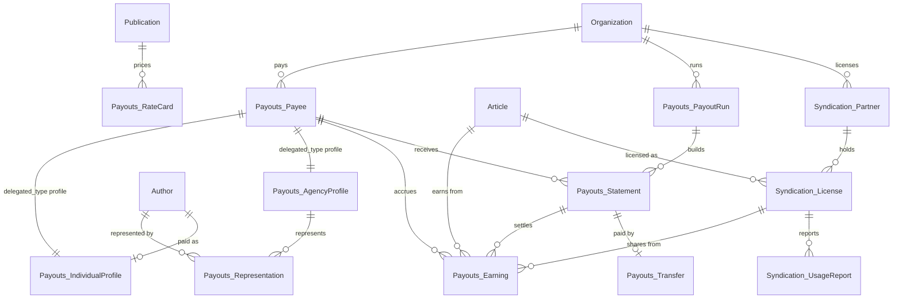

# Plan: contributor payouts and syndication for Canopy

Status: implemented; see the October section of the [validation notes](../canopy-validation.md)
for shipped behavior and measurements. The number is a document sequence, not a
GitHub issue reference.

## Decision

Give Canopy a second revenue story: **it pays the people who write for it, and it
licenses published stories to partner outlets.** Two new domains, `Payouts::` and
`Syndication::`, connect to the existing editorial and billing code.

- **Why this domain:** money that moves out of the business is where real Rails
  apps grow their hardest code: monthly batch runs, ledgers, idempotent
  transfers, tax data, partner APIs, and multi-step state.
- **Why now:** the pass-5 field findings name code shapes the production app has
  and Canopy lacks (see "Shapes from the field" below).
- **Not Woods work.** Another agent owns Woods issues and Woods-specific smokes.
  This plan adds ordinary application code. Contracts change only to describe it.

## The business story

1. An editor publishes a story. Canopy **accrues an earning** for its author from
   the publication's **rate card** (per word, flat fee, or revenue share).
2. An editor **licenses** a published story to a **syndication partner** (another
   outlet). The partner pulls licensed stories through a **versioned partner
   API** and reports **usage** (pickups) back through the same API.
3. License fees create **syndication-share earnings** for the author.
4. Once a month an editor starts a **payout run**. It builds one **statement**
   per payee, holds statements below the minimum payout, and creates a
   **transfer** for each finalized statement.
5. Transfers go to a local fake provider. A first attempt for some payees fails
   and retries. A transfer is never sent twice.
6. A payee is a person (**individual profile**, with an encrypted tax ID) or an
   **agency** that represents several authors and is paid on their behalf.

## Data model



New tables (12), all prefixed by namespace like `billing_*`:

| Table | Model | Notes |
|---|---|---|
| `payouts_payees` | `Payouts::Payee` | `delegated_type :profile`, `enum :status`, belongs to organization |
| `payouts_individual_profiles` | `Payouts::IndividualProfile` | author, `encrypts :tax_id, deterministic: true`, `normalizes :tax_id`, `store_accessor :bank_details` |
| `payouts_agency_profiles` | `Payouts::AgencyProfile` | `normalizes :contact_email`, `accepts_nested_attributes_for :representations` |
| `payouts_representations` | `Payouts::Representation` | agency to author join, one agency per author per organization |
| `payouts_rate_cards` | `Payouts::RateCard` | publication, `enum :basis`, `store_accessor :terms` |
| `payouts_earnings` | `Payouts::Earning` | ledger line, `enum :kind`, unique `(payee, source_type, source_id, kind)`, written with `upsert_all` |
| `payouts_payout_runs` | `Payouts::PayoutRun` | organization, period, `enum :status`, counts |
| `payouts_statements` | `Payouts::Statement` | run plus payee, `enum :status` (draft, held, finalized, paid) |
| `payouts_transfers` | `Payouts::Transfer` STI | `BankTransfer`, `InternationalBankTransfer < BankTransfer` (grandchild), `WalletTransfer`; aasm; `after_commit` enqueue |
| `syndication_partners` | `Syndication::Partner` | organization, `has_secure_token :api_token` (seed sets it explicitly), `encrypts :webhook_secret, deterministic: true` |
| `syndication_licenses` | `Syndication::License` | partner plus article, territory, window, exclusive flag, `default_scope` hides revoked |
| `syndication_usage_reports` | `Syndication::UsageReport` | license, reported period, pickups, upserted by partner reports |

That is 12 tables. Domain total goes from 29 to 41.

## Shapes from the field

The pass-5 package measured a production Rails 7.1 app. These shapes drove its
results. Each one lands here as code a real team would write.

| Field shape | Where it lands |
|---|---|
| Tenant hub model with hundreds of dependents | `Current` (`ActiveSupport::CurrentAttributes`) with `Current.organization`, read by new use cases, policies, jobs, and serializers |
| A controller concern every controller includes | `CurrentTenant`, included **in each controller** (all 11 existing ones and every new one), sets `Current` per request. Deliberate: including it once in `ApplicationController` would give one include edge, not one per controller. |
| A component base class | `ApplicationComponent < Phlex::HTML`; new payout and syndication components subclass it |
| A lib module included by models as a concern (#710) | `lib/canopy/money_columns.rb` (`Canopy::MoneyColumns`), included by `Earning`, `Statement`, `Transfer`, `License` |
| A controller calling a lib class inside an `if` branch | `Payouts::StatementsController#show` calls `Canopy::RoyaltyCalculator.new(...).breakdown` only when a preview is requested |
| STI grandchild | `InternationalBankTransfer < BankTransfer < Transfer` |
| Restart inputs | `config/payouts.yml` read with `config_for`, plus Active Record encryption keys in an initializer |
| Many jobs and serializers | 4 new jobs, 4 new serializers, partner API v1 and v2 |
| Event subscriber with real work | `PayoutsListener` subscribes to `article.published` and accrues the earning. Wired in `config/initializers/event_listeners.rb`. (`ArticleListener.subscribe!` is never called today; left as is.) |

## Rails patterns this adds

Each of these appeared zero times in Canopy before this plan:

- `delegated_type`, Rails `enum`, `store_accessor`, `encrypts`, `normalizes`
- `ActiveSupport::CurrentAttributes`, `default_scope` (and an `unscoped` escape)
- `after_commit`, `upsert_all`, `accepts_nested_attributes_for`, `has_secure_token`
- `ActionController::API` subclass with token auth, versioned routes (`/api/v1`, `/api/v2`)
- Route files split with `draw(:payouts)` and `draw(:syndication)`
- `retry_on` and `discard_on` in jobs; a client under a non-standard `app/clients` directory
- `config_for` for a domain settings file

Deliberately **not** added: Active Storage, Action Text, multiple databases. The
variant requires only selected railties to keep boot small; those three would
change that decision for every run. Recorded as follow-ups.

## Code map

```
app/models/current.rb
app/models/payouts/*.rb            payee, profiles, representation, rate card, earning, run, statement, transfers
app/models/syndication/*.rb        partner, license, usage report
lib/canopy/money_columns.rb        lib concern included by 4 models
lib/canopy/royalty_calculator.rb   lib class used by accrual and statement preview
app/controllers/concerns/current_tenant.rb
app/controllers/payouts/*          payees, payout runs, statements
app/controllers/syndication/*      partners, licenses
app/controllers/api/base_controller.rb, api/v1/*, api/v2/*
app/use_cases/payouts/*            accrue earnings, build statements, finalize run, submit transfer
app/use_cases/syndication/*        grant license, revoke license, record usage
app/clients/payouts/fake_ledger_client.rb
app/jobs/payouts/*, app/jobs/syndication/*
app/listeners/payouts_listener.rb  subscribes to article.published
app/policies/payouts/statement_policy.rb
app/serializers/syndication/*, app/serializers/payouts/*
app/components/application_component.rb and subclasses
app/mailers/contributor_mailer.rb
app/graphql/types/statement_type.rb, query field
config/payouts.yml, config/initializers/active_record_encryption.rb
config/routes/payouts.rb, config/routes/syndication.rb
```

## Invariants (each one gets a spec)

- Publishing the same article twice accrues one earning.
- An earning belongs to one statement at most; a second run for the same period builds nothing new.
- A statement below `minimum_payout_cents` is held and its earnings roll into the next period.
- A transfer is created once per statement and submitted once per idempotency key.
- A failed first submission retries; a permanent rejection discards and marks the statement held.
- An agency is paid for represented authors; that author has no separate payee in that organization.
- Two exclusive licenses for one article cannot overlap in time and territory.
- A partner token only reads its own licenses; revoked licenses vanish from the API.
- Every new record validates that its parts belong to one organization (repo precedent).
- Existing smoke report answers stay unchanged.

## Seeds and contracts

- `Testbed::Dataset`: add the 12 tables to `TABLES`, bump `VERSION` to 2.
- **Payees and rate cards are built in `build_organizations`**, right after authors. Accrual runs from the `article.published` listener, so payees must exist before `build_editorial` publishes.
- `build_syndication` and `build_payouts` run after `build_audience`, inside the same transaction.
- **No seed scenario relies on `after_commit`.** The seed runs in one transaction with the `:test` queue adapter, so commit callbacks fire once at the end and their jobs are dropped. The seed calls `Payouts::SubmitTransferJob.perform_now` explicitly, twice for the fail-then-succeed transfer, like `WebhookDeliveryJob` in `build_audience`.
- **Determinism:** API tokens are set explicitly; encrypted columns use deterministic encryption with fixed dev/test keys.
- `canopy_dataset_check.rb` requires every table to have rows. Every new table gets smoke rows, including all three transfer classes and usage reports.
- **Widen the smoke row bound** in `canopy_dataset_check.rb` (900 to 1,100 today, about 940 used). Update the README profile table with the measured totals.
- Named scenarios: `CANOPY-HELD` (statement held below minimum), `CANOPY-AGENCY` (agency paid for two authors), `canopy-story-3` (exclusive license), a transfer that failed once then succeeded.
- `functional_contract.yml`: new models, units, retrieval probes, and smoke report answers for payouts.
- `kernel_contract.yml`: describe `CurrentTenant` (with a `known_gem_issues` entry for woods#175, same root cause as `RequiresAuthor`) and `Canopy::MoneyColumns`. Run the contract smoke locally before committing. Existing exact counts (`Archivable` 3, `Auditable` 1, `RequiresAuthor` 2) stay untouched.
- After the migration, `git diff db/schema.rb` must show additions only; `gen_hubs` and `gen_records` stay.

## Delivery

TDD per slice, in this order:

1. **Foundation** (main session): migration, all models, `Current`, `CurrentTenant` in every controller, lib concern, config, encryption, `Payouts::AccrueEarning` (the one writer of `payouts_earnings`), both `draw` lines in `config/routes.rb` with empty route files. Model specs.
2. **Payouts** (parallel): run, statements, transfers, client, jobs, listener, mailer. Workflow specs.
3. **Syndication** (parallel): licenses, usage, partner API v1 and v2. Calls `AccrueEarning`; never writes earnings directly. Request specs.
4. **UI** (after 2 and 3): payouts and syndication pages, components, policy, GraphQL. Request specs.
5. **Seeds, contracts, docs** (main session).

Slices 2 and 3 share no files. Each owns its own route file, namespace directories, and spec files.

## Follow-ups (not in this plan)

- Active Storage for signed contributor agreements.
- A second database for the usage-report firehose.
- A `rails-7.1` variant that mirrors the field app's Rails version.
